<p align="center">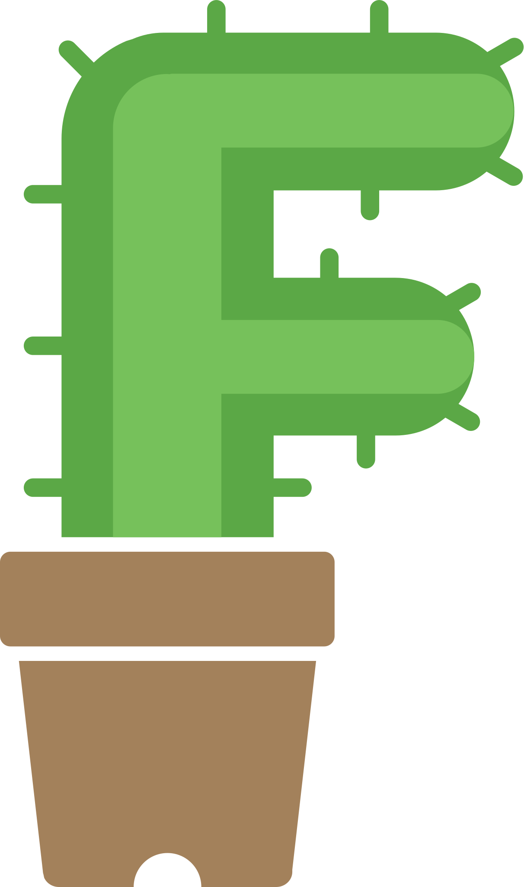</p>
<h1 align="center">ShapoFont</h1>
<p align="center">シャポフォント</p>
<p align="center">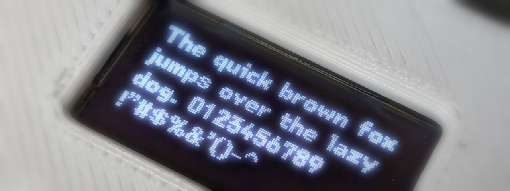</p>

- Bitmap fonts for embedded projects<br>
    組み込み向けビットマップフォント
- Tools for generating [GFXfont](https://github.com/adafruit/Adafruit-GFX-Library) and [LVGL](https://lvgl.io/) fonts from PNG images<br>
    「ペイント」などでデザインしたフォントから GFXfont / LVGL フォントを生成するツール

# Font Catalog

Click thumbnail to open the font with the [Web Simulator](https://shapoco.github.io/shapofont/sim/).<br>
サムネイルをクリックすると[ブラウザ上のシミュレータ](https://shapoco.github.io/shapofont/sim/)でお試しできます。

- **GFXfont**: 1 bpp (monochrome) fonts for Adafruit GFX, LovyanGFX, etc.
- **LVGL**: 1 bpp (monochrome) and 2 bpp (grayscale) fonts for LVGL v8 / v9.

The simulator can also load any GFXfont or LVGL font (plain or compressed) from a GitHub / Gist URL pasted into its URL box.<br>
シミュレータは GitHub / Gist 上の任意の GFXfont / LVGL フォント (非圧縮・圧縮) の URL を貼り付けて読み込むこともできます。

<!-- SHAPOFONT_START_OF_FONT_CATALOG -->

## ShapoSansP

Proportional fonts for embedded projects

|Sample|Downloads (Footprint)|
|:--|:--|
|<a href="https://shapoco.github.io/shapofont/sim/#u=/shapofont/ShapoSansP_s05.h" target="_blank">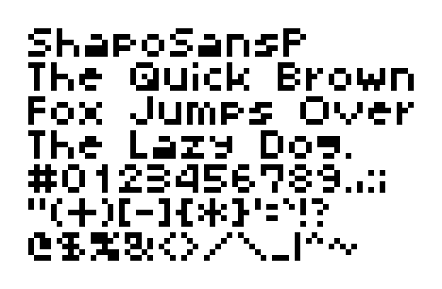</a>|**s05**<br>[GFXfont](gfxfont/cpp/include/ShapoSansP_s05.h) (985 B)<br>[LVGL](lvgl/ShapoSansP_s05.c) (1.06 kB)|
|<a href="https://shapoco.github.io/shapofont/sim/#u=/shapofont/ShapoSansP_s07c05a01.h" target="_blank">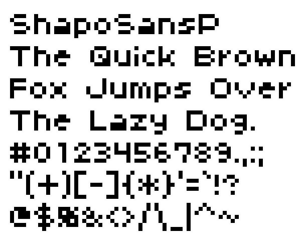</a>|**s07c05a01**<br>[GFXfont](gfxfont/cpp/include/ShapoSansP_s07c05a01.h) (1021 B)<br>[LVGL](lvgl/ShapoSansP_s07c05a01.c) (1.09 kB)|
|<a href="https://shapoco.github.io/shapofont/sim/#u=/shapofont/ShapoSansP_s08c07.h" target="_blank">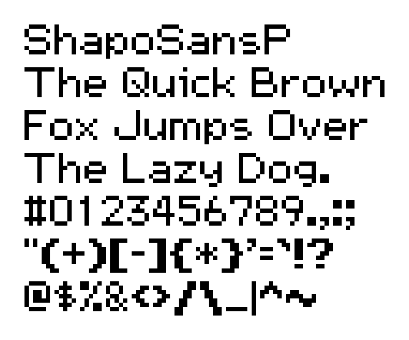</a>|**s08c07**<br>[GFXfont](gfxfont/cpp/include/ShapoSansP_s08c07.h) (1.15 kB)<br>[LVGL](lvgl/ShapoSansP_s08c07.c) (1.23 kB)|
|<a href="https://shapoco.github.io/shapofont/sim/#u=/shapofont/ShapoSansP_s12c09a01w02.h" target="_blank">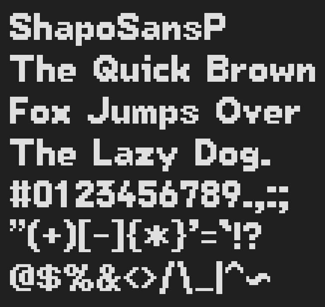</a>|**s12c09a01w02**<br>[GFXfont](gfxfont/cpp/include/ShapoSansP_s12c09a01w02.h) (1.32 kB)<br>[LVGL](lvgl/ShapoSansP_s12c09a01w02.c) (1.41 kB)|
|<a href="https://shapoco.github.io/shapofont/sim/#u=/shapofont/ShapoSansP_s21c16a01w03.h" target="_blank">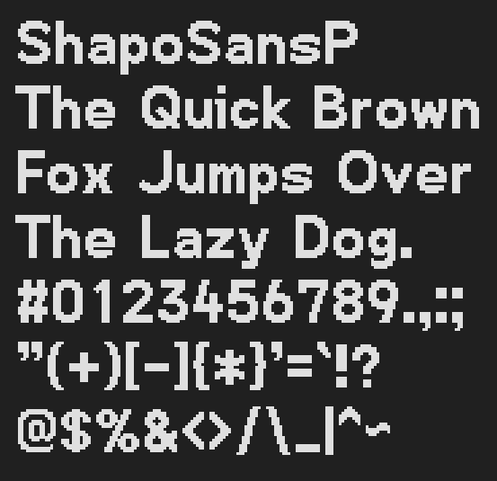</a>|**s21c16a01w03**<br>[GFXfont](gfxfont/cpp/include/ShapoSansP_s21c16a01w03.h) (2.37 kB)<br>[LVGL](lvgl/ShapoSansP_s21c16a01w03.c) (2.46 kB)|
|<a href="https://shapoco.github.io/shapofont/sim/#u=/shapofont/ShapoSansP_s27c22a01w04.h" target="_blank">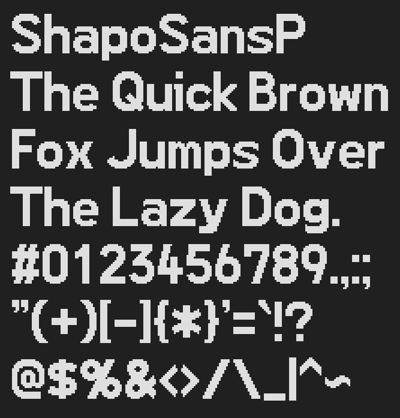</a>|**s27c22a01w04**<br>[GFXfont](gfxfont/cpp/include/ShapoSansP_s27c22a01w04.h) (3.67 kB)<br>[LVGL](lvgl/ShapoSansP_s27c22a01w04.c) (3.77 kB)|


## ShapoSansDigitP

Proportional number fonts for embedded projects

|Sample|Downloads (Footprint)|
|:--|:--|
|<a href="https://shapoco.github.io/shapofont/sim/#u=/shapofont/ShapoSansDigitP_s16c14w02.h" target="_blank">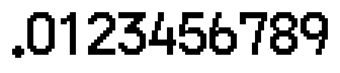</a>|**s16c14w02**<br>[GFXfont](gfxfont/cpp/include/ShapoSansDigitP_s16c14w02.h) (261 B)<br>[LVGL](lvgl/ShapoSansDigitP_s16c14w02.c) (371 B)|
|<a href="https://shapoco.github.io/shapofont/sim/#u=/shapofont/ShapoSansDigitP_s24c23w04.h" target="_blank">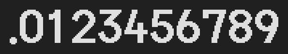</a>|**s24c23w04**<br>[GFXfont](gfxfont/cpp/include/ShapoSansDigitP_s24c23w04.h) (547 B)<br>[LVGL](lvgl/ShapoSansDigitP_s24c23w04.c) (657 B)|
|<a href="https://shapoco.github.io/shapofont/sim/#u=/shapofont/ShapoSansDigitP_s32c30w04.h" target="_blank">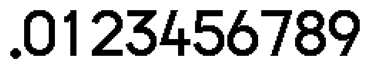</a>|**s32c30w04**<br>[GFXfont](gfxfont/cpp/include/ShapoSansDigitP_s32c30w04.h) (818 B)<br>[LVGL](lvgl/ShapoSansDigitP_s32c30w04.c) (928 B)|


## ShapoSansMono

Monospaced fonts for embedded projects

|Sample|Downloads (Footprint)|
|:--|:--|
|<a href="https://shapoco.github.io/shapofont/sim/#u=/shapofont/ShapoSansMono_s08c07.h" target="_blank">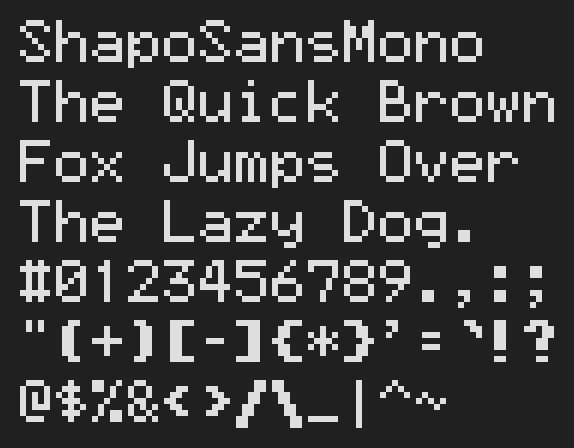</a>|**s08c07**<br>[GFXfont](gfxfont/cpp/include/ShapoSansMono_s08c07.h) (1.12 kB)<br>[LVGL](lvgl/ShapoSansMono_s08c07.c) (1.21 kB)|


## ShapoSquareRoundP

Proportional fonts for embedded projects

|Sample|Downloads (Footprint)|
|:--|:--|
|<a href="https://shapoco.github.io/shapofont/sim/#u=/shapofont/ShapoSquareRoundP_s12c09a01w02.h" target="_blank">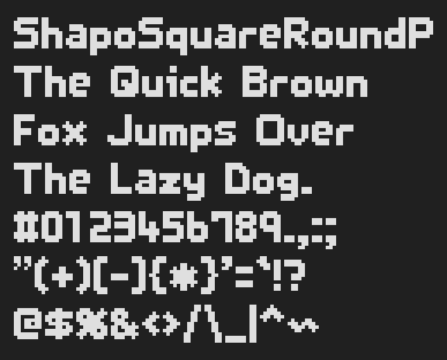</a>|**s12c09a01w02**<br>[GFXfont](gfxfont/cpp/include/ShapoSquareRoundP_s12c09a01w02.h) (1.33 kB)<br>[LVGL](lvgl/ShapoSquareRoundP_s12c09a01w02.c) (1.42 kB)|
|<a href="https://shapoco.github.io/shapofont/sim/#u=/shapofont/ShapoSquareRoundP_s21c16a01w03.h" target="_blank">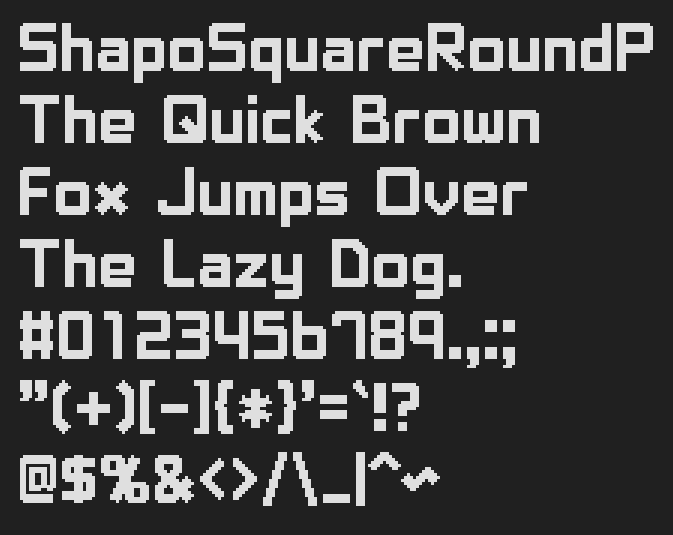</a>|**s21c16a01w03**<br>[GFXfont](gfxfont/cpp/include/ShapoSquareRoundP_s21c16a01w03.h) (2.35 kB)<br>[LVGL](lvgl/ShapoSquareRoundP_s21c16a01w03.c) (2.44 kB)|
|<a href="https://shapoco.github.io/shapofont/sim/#u=/shapofont/ShapoSquareRoundP_s27c22a01w04.h" target="_blank">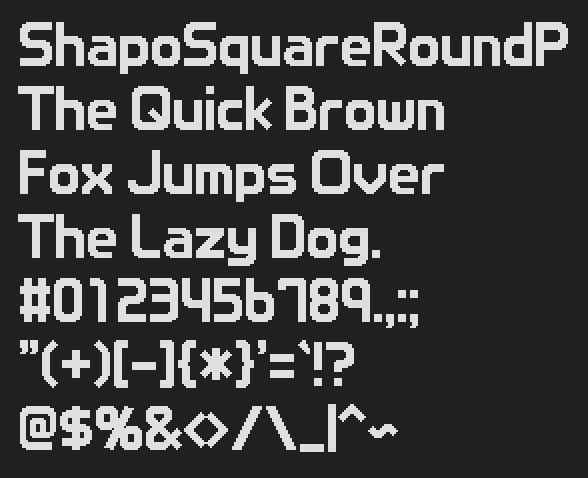</a>|**s27c22a01w04**<br>[GFXfont](gfxfont/cpp/include/ShapoSquareRoundP_s27c22a01w04.h) (3.59 kB)<br>[LVGL](lvgl/ShapoSquareRoundP_s27c22a01w04.c) (3.76 kB)|


## WcbSansP

Proportional fonts designed for WildCardBoy

|Sample|Downloads (Footprint)|
|:--|:--|
|<a href="https://shapoco.github.io/shapofont/sim/#u=/shapofont/lvgl/WcbSansP_s18c14a01g02.c" target="_blank">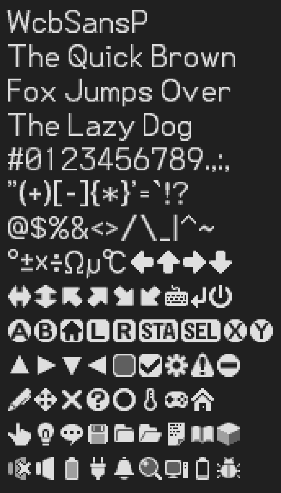</a>|**s18c14a01g02**<br>(GFXfont not available: grayscale)<br>[LVGL](lvgl/WcbSansP_s18c14a01g02.c) (3.16 kB)|


## MameSansP

Proportional fonts

|Sample|Downloads (Footprint)|
|:--|:--|
|<a href="https://shapoco.github.io/shapofont/sim/#u=/shapofont/MameSansP_s15c12.h" target="_blank">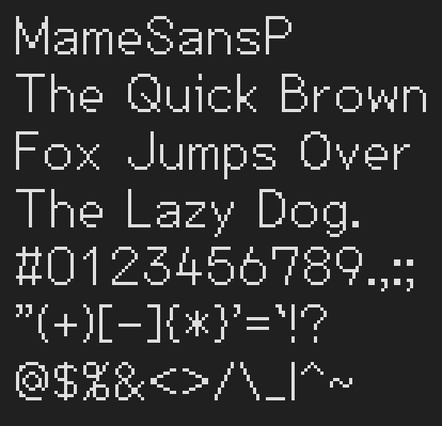</a>|**s15c12**<br>[GFXfont](gfxfont/cpp/include/MameSansP_s15c12.h) (1.54 kB)<br>[LVGL](lvgl/MameSansP_s15c12.c) (1.64 kB)|
|<a href="https://shapoco.github.io/shapofont/sim/#u=/shapofont/lvgl/MameSansP_s15c12g02.c" target="_blank">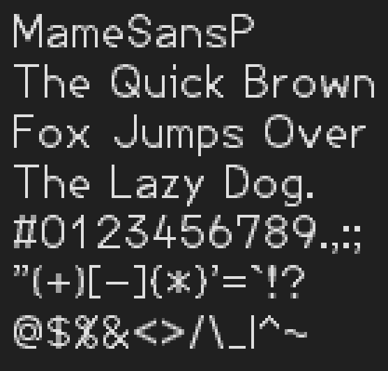</a>|**s15c12g02**<br>(GFXfont not available: grayscale)<br>[LVGL](lvgl/MameSansP_s15c12g02.c) (2.45 kB)|
|<a href="https://shapoco.github.io/shapofont/sim/#u=/shapofont/MameSansP_s15c12w02.h" target="_blank">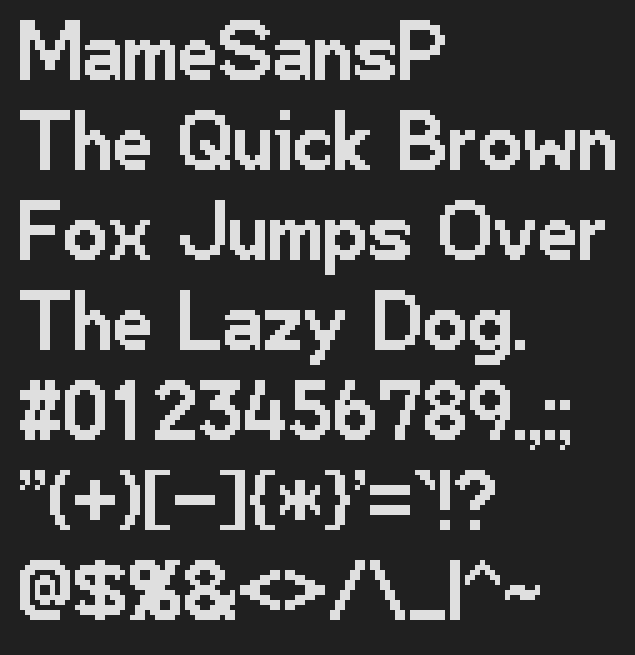</a>|**s15c12w02**<br>[GFXfont](gfxfont/cpp/include/MameSansP_s15c12w02.h) (1.64 kB)<br>[LVGL](lvgl/MameSansP_s15c12w02.c) (1.73 kB)|
|<a href="https://shapoco.github.io/shapofont/sim/#u=/shapofont/lvgl/MameSansP_s15c12w02g02.c" target="_blank">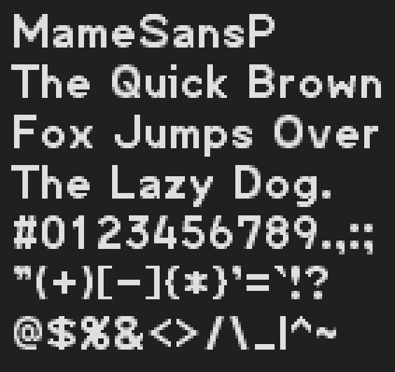</a>|**s15c12w02g02**<br>(GFXfont not available: grayscale)<br>[LVGL](lvgl/MameSansP_s15c12w02g02.c) (2.64 kB)|
|<a href="https://shapoco.github.io/shapofont/sim/#u=/shapofont/MameSansP_s48c40w08.h" target="_blank">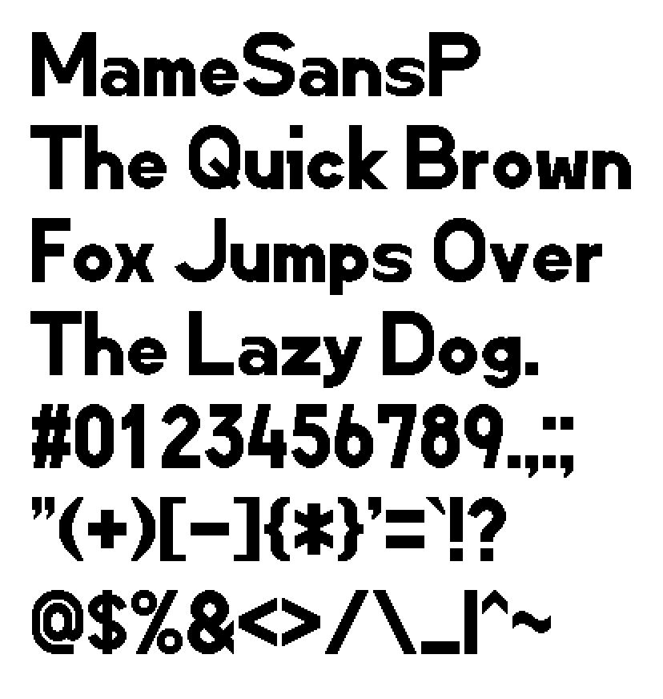</a>|**s48c40w08**<br>[GFXfont](gfxfont/cpp/include/MameSansP_s48c40w08.h) (9.89 kB)<br>[LVGL](lvgl/MameSansP_s48c40w08.c) (10.24 kB)|


## MameSansDigitP

Proportional number fonts

|Sample|Downloads (Footprint)|
|:--|:--|
|<a href="https://shapoco.github.io/shapofont/sim/#u=/shapofont/MameSansDigitP_s64w08.h" target="_blank">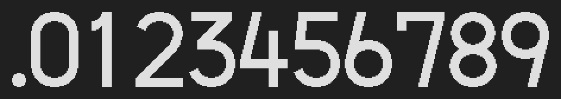</a>|**s64w08**<br>[GFXfont](gfxfont/cpp/include/MameSansDigitP_s64w08.h) (3.05 kB)<br>[LVGL](lvgl/MameSansDigitP_s64w08.c) (3.16 kB)|


## MameSeg7

7-segment display fonts

|Sample|Downloads (Footprint)|
|:--|:--|
|<a href="https://shapoco.github.io/shapofont/sim/#u=/shapofont/lvgl/MameSeg7_s22c20w03g02.c" target="_blank">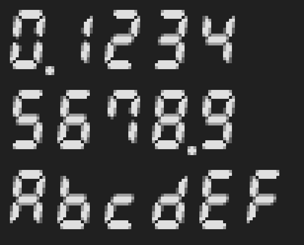</a>|**s22c20w03g02**<br>(GFXfont not available: grayscale)<br>[LVGL](lvgl/MameSeg7_s22c20w03g02.c) (1.07 kB)|
|<a href="https://shapoco.github.io/shapofont/sim/#u=/shapofont/MameSeg7_s40c38w06.h" target="_blank"></a>|**s40c38w06**<br>[GFXfont](gfxfont/cpp/include/MameSeg7_s40c38w06.h) (1.70 kB)<br>[LVGL](lvgl/MameSeg7_s40c38w06.c) (1.79 kB)|
|<a href="https://shapoco.github.io/shapofont/sim/#u=/shapofont/lvgl/MameSeg7_s40c38w06g02.c" target="_blank">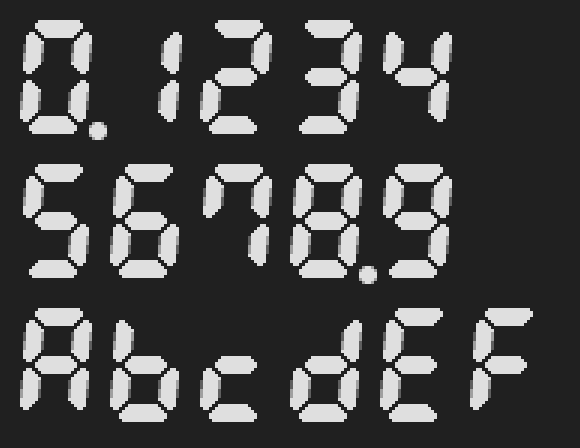</a>|**s40c38w06g02**<br>(GFXfont not available: grayscale)<br>[LVGL](lvgl/MameSeg7_s40c38w06g02.c) (3.27 kB)|


## MameSquareWide

Square wide fonts

|Sample|Downloads (Footprint)|
|:--|:--|
|<a href="https://shapoco.github.io/shapofont/sim/#u=/shapofont/MameSquareWide_s64c48a04w16.h" target="_blank">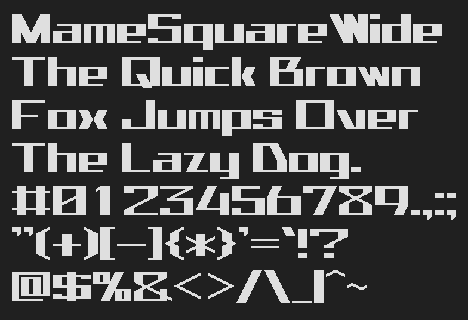</a>|**s64c48a04w16**<br>[GFXfont](gfxfont/cpp/include/MameSquareWide_s64c48a04w16.h) (21.88 kB)<br>[LVGL](lvgl/MameSquareWide_s64c48a04w16.c) (23.07 kB)|

<!-- SHAPOFONT_END_OF_FONT_CATALOG -->

# Using GFXfont in LovyanGFX

Before including the generated GFXfont, define the `SHAPOFONT_GFXFONT_NAMESPACE=::lgfx::` macro so that it can be used with LovyanGFX.

```c++
#define SHAPOFONT_GFXFONT_NAMESPACE ::lgfx::
#include "shapofont/ShapoSansP_s12c09a01w02.h"
```

# Using LVGL Fonts

The files in [lvgl/](lvgl/) are standard LVGL font sources in the same format as the output of [lv_font_conv](https://github.com/lvgl/lv_font_conv) (uncompressed, LVGL v8 and v9). Add the `.c` file to your build and declare the font:

```c++
LV_FONT_DECLARE(ShapoSansP_s12c09a01w02);

lv_obj_set_style_text_font(label, &ShapoSansP_s12c09a01w02, 0);
```

Fonts whose name contains `g02` are 2 bpp grayscale fonts. They are available only in LVGL format.

# Designing Font with Painting Tool

ShapoFonts are designed using painting tools such as Microsoft Paint and converted to GFXfont / LVGL fonts by a Python tool.<br>
ShapoFont は「ペイント」などのペイントソフトでデザインされ、Python 製のツールを使って GFXfont / LVGL フォントに変換されています。

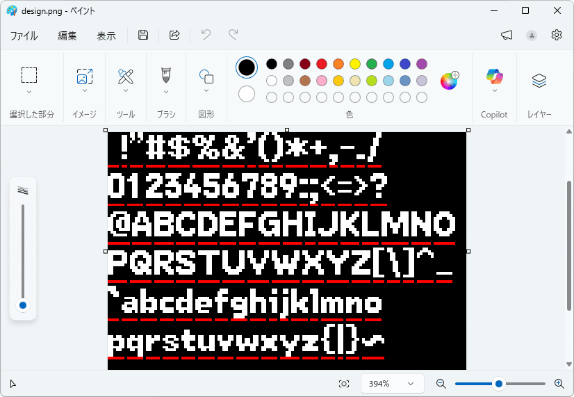

## Requirements

- Painting Tool (I used mspaint)
- Linux environment with Python (I used WSL2)

## Naming Rule

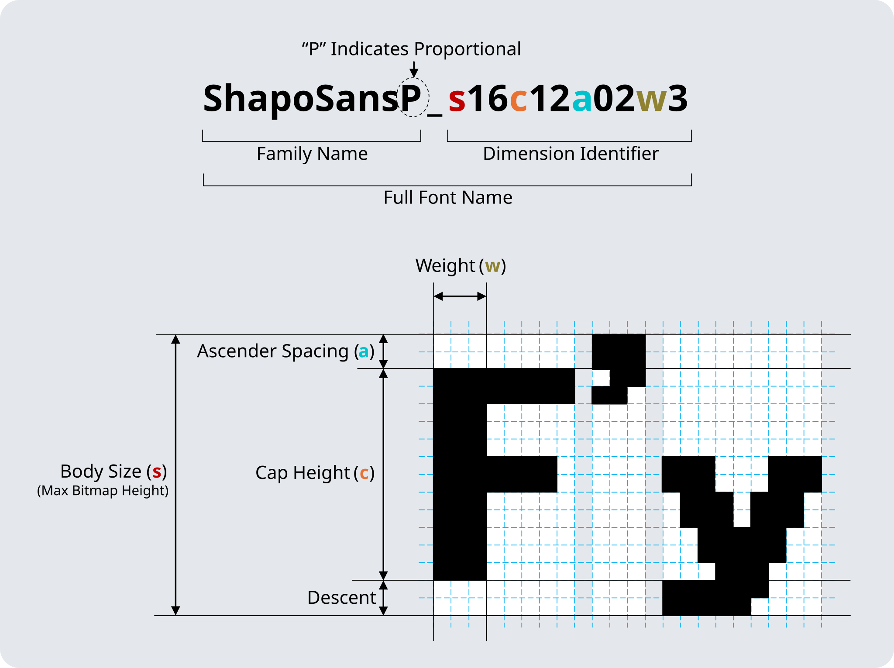

|Option|Description|Default Value|
|:--:|:--|:--:|
|s|Body Size|(required)|
|c|Cap Height|s|
|a|Ascender Spacing|0|
||Descent|s - c - a|
|w|Weight|1|
|g|Bits per Pixel (1: monochrome, 2: 4-level grayscale)|1|

Example: `ShapoSansP_s12c09a01w02` is a 12 px font with a cap height of 9 px, 1 px ascender spacing and a weight of 2 px.

## How to Design Your Own Font

1. Create a canvas of appropriate size with a black background.
2. Design your glyphs in white (for grayscale fonts, use black, 33%, 67% and 100% gray).
3. Add a red line (**Glyph Marker**) of the same width at the bottom of each glyph.

    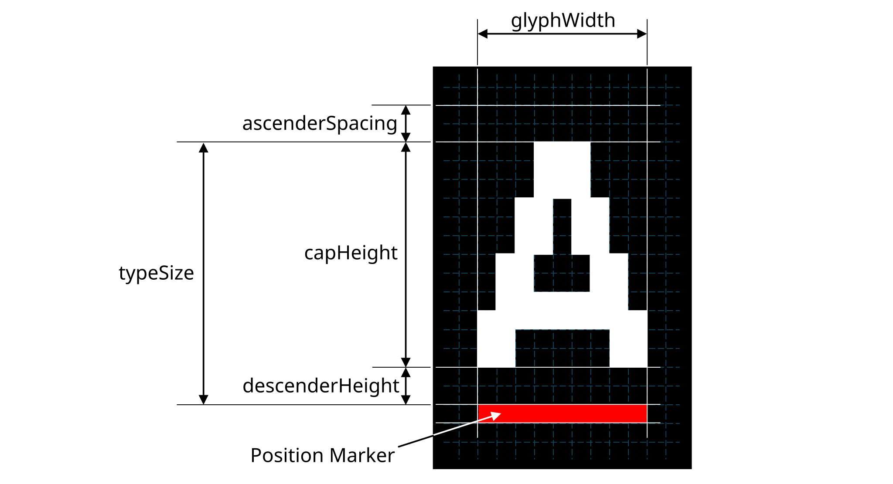

4. Save the image as `design.png`.
5. In a JSON file `design.json`, list the characters contained in the image.

    ```json
    {
        "codes": [
            {
                "from": 32,
                "to": 126
            }
        ],
        "dimensions": {
            "body_size": 12,
            "cap_height": 9,
            "ascender_spacing": 1,
            "weight": 2,
            "x_spacing": 1,
            "y_spacing": 5
        }
    }
    ```

    |Key|Description|Default Value|
    |:--|:--|:--:|
    |codes|Character code ranges, in the order the glyphs appear in the image|0x20 - 0x7E|
    |dimensions.body_size, cap_height, ascender_spacing, weight|Same as the naming rule above|(from directory name)|
    |dimensions.x_spacing|Default horizontal spacing between glyphs|ceil(body_size / 16)|
    |dimensions.y_spacing|Extra vertical spacing between lines|ceil((body_size - ascender_spacing) * 1.2 - body_size)|
    |bits_per_pixel|1 or 2|(from directory name)|
    |sample.text, sample.size|Text and scale of the sample image|(auto)|

    If `dimensions` are omitted, the tool extracts the dimension values from the directory name of the design file.

- The vertical positions of the glyph markers of the glyphs side by side must be aligned.
- There must be at least Body Size pixels of space above the glyph marker (no overlap).
- The order of characters in the image must exactly match the order of characters listed in the `design.json`.

### Spacing Adjustment

If only glyph marker (red line) is given in design image, when rendering it, the character's horizontal coordinate is advanced by the glyph width plus default spacing defined in JSON. If you want to adjust the spacing for each character, you can add blue lines.

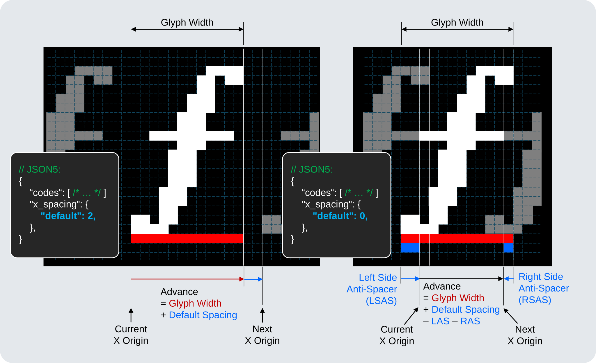

The blue line just below the left edge of the glyph marker (Left Side Anti-Spacer, LSAS) decreases the spacing on the left side, and the blue line just below the right edge (Right Side Anti-Spacer, RSAS) decreases the spacing on the right side.

## Directory Structure

Create a directory with full font name and place a design image and meta information in it.

### Example:

```
ShapoSansP_s21c16a01w03/  ... Full Font Name
+-- design.png  ............. Font Design File
+-- design.json  ............ Meta Information
```

If `dimensions` is not specified in JSON, the generator script extracts a family name and a dimension identifier from the directory name, so they must be named correctly.

## Converting to GFXfont / LVGL Font

1. Create a Python virtual environment and install the `shapofont` package into it using `venv-setup.shrc`.
2. Run `shapofont convert` with the design directory to generate each font format.
    - `-i`: path to the design directory
    - `--gfx-outdir`: output directory for the GFXfont header (`<name>.h`, 1 bpp fonts only)
    - `--lvgl-outdir`: output directory for the LVGL font source (`<name>.c`)
    - `--sample-img`: path of a sample PNG image to render

### Example:

```bash
source venv-setup.shrc
./venv/bin/shapofont convert \
      -i design/ShapoSansP_s21c16a01w03 \
      --gfx-outdir path/to/output/dir/ \
      --lvgl-outdir path/to/output/dir/
```

In this repository, after creating the venv, run `make configure` once when fonts are added or removed, then `make -j all` to convert all fonts and `make catalog` to update the catalog in this README.

The tool lives in [src/shapofont/](src/shapofont/) and can also be run as `python3 -m shapofont`. Run the tests with `make test`.

# License

see [LICENSE](LICENSE).

The rights to font files generated using the tools included in ShapoFont are subject to the rights of the original bitmap images and any fonts contained therein.

# Memo

## ASCII (JIS X 0201) Code Table

```
      0   1   2   3   4   5   6   7   8   9   A   B   C   D   E   F
0x00  NUL SOH STX ETX EOT ENQ ACK BEL BS  HT  LF  VT  FF  CR  SO  SI
0x10  DLE DC1 DC2 DC3 DC4 NAK SYN ETB CAN EM  SUB ESC FS  GS  RS  US
0x20  SP  !   "   #   $   %   &   '   (   )   *   +   ,   -   .   /
0x30  0   1   2   3   4   5   6   7   8   9   :   ;   <   =   >   ?
0x40  @   A   B   C   D   E   F   G   H   I   J   K   L   M   N   O
0x50  P   Q   R   S   T   U   V   W   X   Y   Z   [   \   ]   ^   _
0x60  `   a   b   c   d   e   f   g   h   i   j   k   l   m   n   o
0x70  p   q   r   s   t   u   v   w   x   y   z   {   |   }   ~   DEL
0x80
0x90
0xA0      ｡   ｢   ｣   ､   ･   ｦ   ｧ   ｨ   ｩ   ｪ   ｫ   ｬ   ｭ   ｮ   ｯ
0xB0  ｰ   ｱ   ｲ   ｳ   ｴ   ｵ   ｶ   ｷ   ｸ   ｹ   ｺ   ｻ   ｼ   ｽ   ｾ   ｿ
0xC0  ﾀ   ﾁ   ﾂ   ﾃ   ﾄ   ﾅ   ﾆ   ﾇ   ﾈ   ﾉ   ﾊ   ﾋ   ﾌ   ﾍ   ﾎ   ﾏ
0xD0  ﾐ   ﾑ   ﾒ   ﾓ   ﾔ   ﾕ   ﾖ   ﾗ   ﾘ   ﾙ   ﾚ   ﾛ   ﾜ   ﾝ   ﾞ   ﾟ
0xE0
0xF0
```
